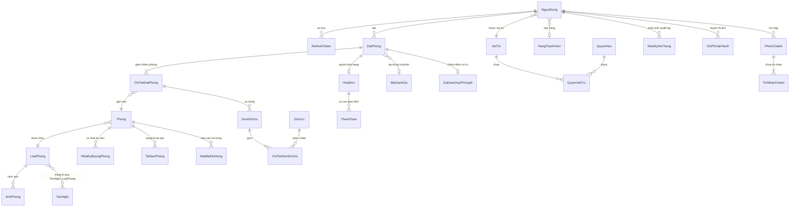

# 🏢 BÁO CÁO PHÂN TÍCH NGHIỆP VỤ HỆ THỐNG (DOMAIN ANALYSIS)
## Dự Án: Hệ Thống Đặt Phòng Khách Sạn & Trợ Lý Du Lịch Thông Minh — BookingStay.AI (DACN)

> **Tài liệu chuẩn hóa nghiệp vụ dành cho Developer & AI Agents**  
> **Cập nhật:** 20/11/2026 | **Phiên bản:** 2.0 (Full-stack Integration TV1 - TV4)

---

## 📌 BƯỚC 1: XÁC ĐỊNH DOMAIN & PHẠM VI (SCOPE)

### 1.1. Tên Hệ Thống & Định Vị Sản Phẩm
* **Tên thương mại:** **BookingStay.AI** — Nền tảng Đặt phòng Khách sạn & Trợ lý Du lịch Toàn diện.
* **Mô hình nghiệp vụ:** Khách sạn thông minh (Smart Hotel Management System - PMS) kết hợp Cổng thông tin du lịch và trợ lý ảo AI (Travel Advisory & Booking Portal).
* **Kiến trúc:** ASP.NET Core 9.0 Web API kết hợp Blazor Server (Interactive Server RenderMode), cơ sở dữ liệu Microsoft SQL Server.

### 1.2. Mục Tiêu Nghiệp Vụ
1. **Khách hàng (Customer-facing):**
   * Tìm kiếm, tra cứu loại phòng, xem giá theo thời gian thực và đặt phòng trực tuyến.
   * Nhận gợi ý du lịch cá nhân hóa (AI Recommender) dựa trên ngân sách, mùa du lịch, gu trải nghiệm (check-in, nghỉ dưỡng, ẩm thực...).
   * Tương tác với Chatbot AI để hỏi đáp lịch trình du lịch, tiện ích khách sạn (Hybrid RAG kết hợp CSDL nội bộ và Google Gemini API).
   * Áp dụng mã voucher giảm giá có kiểm soát ngân sách; tích lũy điểm và thăng hạng thành viên (Genius / Loyalty Tiers).
2. **Quản trị vận hành nội bộ (Internal Staff & Management):**
   * **Tiền sảnh (Front-desk):** Sơ đồ phòng trực quan (Room Rack), tiếp nhận khách vãng lai (Walk-in), Check-in / Check-out, tính phụ thu, thuế VAT và quyết toán.
   * **Thu ngân & Dịch vụ:** Ghi nhận order dịch vụ phòng (minibar, ăn uống, giặt ủi, spa...), tự động cộng dồn hóa đơn theo thời gian thực.
   * **Buồng phòng (Housekeeping):** Điều phối ca trực dọn dẹp, cập nhật trạng thái buồng phòng (Sạch / Bẩn / Đang dọn / Bảo trì), kiểm kê tài sản & ghi nhận hư hỏng đền bù.
   * **Kế toán & Chi phí:** Quản lý danh mục chi phí vận hành (điện nước, vật tư, lương...), phân loại dòng tiền thu - chi.
   * **Quản lý & Giám đốc (BI & AI Decision Support):** Báo cáo chỉ số KPI ngành khách sạn (Occupancy %, ADR, RevPAR, Doanh thu), mô hình AI dự báo nhu cầu phòng 14 ngày tới và chấm điểm rủi ro hủy phòng (Churn Risk).
   * **Quản trị viên (Admin):** Quản lý tài khoản nhân viên, ma trận phân quyền chi tiết (RBAC 18 quyền), cấu hình kho voucher, quản trị bài viết cẩm nang và tra cứu nhật ký kiểm toán hệ thống (Audit Logs).

---

## 👥 BƯỚC 2: STAKEHOLDERS & MA TRẬN PHÂN QUYỀN (RBAC MATRIX)

Hệ thống triển khai mô hình **Role-Based Access Control (RBAC)** với **6 Vai trò (Roles)** và **18 Quyền hạn (Permissions)** chuẩn hóa trong bảng `QuyenHan` và `QuyenVaiTro`.

### 2.1. Danh Sách 6 Vai Trò (Roles)
1. **Quản Trị Viên (Admin - ID 1):** Toàn quyền cấu hình hệ thống, quản lý tài khoản nhân sự và phân bổ quyền hạn.
2. **Quản Lý Khách Sạn (Manager - ID 2):** Điều hành toàn bộ hoạt động kinh doanh, buồng phòng, thu chi và khai thác báo cáo AI/BI; không được can thiệp vào tài khoản admin khác hoặc ma trận quyền gốc.
3. **Lễ Tân (FrontDesk - ID 3):** Phụ trách trực quầy tiền sảnh, sơ đồ buồng phòng, check-in, check-out, tiếp nhận yêu cầu dịch vụ của khách.
4. **Nhân Viên Buồng Phòng (Housekeeping - ID 4):** Phụ trách dọn dẹp phòng, cập nhật trạng thái sạch/bẩn, kiểm kê tiện nghi và báo cáo hỏng hóc tài sản.
5. **Kế Toán (Accountant - ID 5):** Giám sát hóa đơn, phiếu thanh toán thu ngân, ghi nhận và phê duyệt chi phí vận hành khách sạn.
6. **Khách Hàng (Customer - ID 6):** Người dùng đặt phòng trực tuyến, tra cứu lịch sử lưu trú, sử dụng AI Chatbot và đánh giá dịch vụ.

### 2.2. Danh Mục 18 Quyền Hạn Chuẩn (`Common/Quyen.cs`)
| Mã ID | Tên Quyền (Constant) | Phân Hệ | Diễn Giải Chi Tiết |
| :---: | :--- | :--- | :--- |
| **1** | `ViewDashboard` | Báo cáo / BI | Xem Dashboard tổng quan doanh thu ca trực, biểu đồ phòng và KPI vận hành |
| **2** | `ManageRooms` | Phòng | Thêm, sửa, xóa cấu hình phòng, loại phòng và tiện nghi |
| **3** | `ManageBookings` | Đặt phòng | Tạo mới, duyệt, chỉnh sửa và hủy đơn đặt phòng |
| **4** | `CheckInOut` | Tiền sảnh | Thực hiện thủ tục nhận phòng (Check-in) và trả phòng (Check-out) |
| **5** | `ManageInvoices` | Hóa đơn | Lập, in, điều chỉnh và xuất hóa đơn lưu trú |
| **6** | `ManagePayments` | Thu ngân | Ghi nhận giao dịch thanh toán (Tiền mặt, Chuyển khoản, VNPay, MoMo) |
| **7** | `ManageServices` | Dịch vụ | Quản lý danh mục dịch vụ khách sạn và đơn giá |
| **8** | `OrderRoomService` | Tiền sảnh | Ghi nhận yêu cầu gọi đồ ăn, minibar, giặt ủi cho khách tại phòng |
| **9** | `ManageHousekeeping` | Buồng phòng | Phân công ca trực vệ sinh buồng phòng và kiểm tra chất lượng dọn phòng |
| **10** | `UpdateRoomStatus` | Buồng phòng | Chuyển trạng thái buồng phòng (Sạch, Bẩn, Đang dọn, Bảo trì) |
| **11** | `ManageUsers` | Quản trị | Quản lý người dùng, khóa/mở khóa tài khoản, đổi vai trò và phân quyền RBAC |
| **12** | `ManageVouchers` | Marketing | Tạo mã ưu đãi, đặt điều kiện giảm giá, tỷ lệ %, áp trần giảm tối đa |
| **13** | `ManageArticles` | Nội dung | Đăng và biên tập bài viết cẩm nang du lịch, tọa độ check-in |
| **14** | `ModerateReviews` | Nội dung | Kiểm duyệt đánh giá khách hàng (Duyệt hiển thị hoặc ẩn review spam) |
| **15** | `UseAIChatbot` | Trí tuệ AI | Truy cập và trò chuyện với trợ lý ảo AI BookingStay |
| **16** | `ViewAIPredictions` | Trí tuệ AI | Chạy mô hình dự báo nhu cầu đặt phòng và cảnh báo rủi ro hủy đơn |
| **17** | `ManageExpenses` | Tài chính | Thêm, sửa, xóa, duyệt và thống kê các khoản chi phí vận hành |
| **18** | `ManageAIData` | Dữ liệu AI | Quản lý tập dữ liệu địa điểm tham quan, mùa du lịch và tour phục vụ AI |

### 2.3. Bảng Ma Trận Phân Quyền (RBAC Mapping)
| Quyền Hạn | Admin | Manager | FrontDesk | Housekeeping | Accountant | Customer |
| :--- | :---: | :---: | :---: | :---: | :---: | :---: |
| 1. `ViewDashboard` | ✅ | ✅ | ❌ | ❌ | ✅ | ❌ |
| 2. `ManageRooms` | ✅ | ✅ | ❌ | ❌ | ❌ | ❌ |
| 3. `ManageBookings` | ✅ | ✅ | ✅ | ❌ | ❌ | ❌ |
| 4. `CheckInOut` | ✅ | ✅ | ✅ | ❌ | ❌ | ❌ |
| 5. `ManageInvoices` | ✅ | ✅ | ✅ | ❌ | ✅ | ❌ |
| 6. `ManagePayments` | ✅ | ✅ | ✅ | ❌ | ✅ | ❌ |
| 7. `ManageServices` | ✅ | ✅ | ❌ | ❌ | ❌ | ❌ |
| 8. `OrderRoomService` | ✅ | ✅ | ✅ | ❌ | ❌ | ❌ |
| 9. `ManageHousekeeping` | ✅ | ✅ | ❌ | ✅ | ❌ | ❌ |
| 10. `UpdateRoomStatus` | ✅ | ✅ | ✅ | ✅ | ❌ | ❌ |
| 11. `ManageUsers` | ✅ | ❌ *(Bảo mật)* | ❌ | ❌ | ❌ | ❌ |
| 12. `ManageVouchers` | ✅ | ✅ | ❌ | ❌ | ❌ | ❌ |
| 13. `ManageArticles` | ✅ | ✅ | ❌ | ❌ | ❌ | ❌ |
| 14. `ModerateReviews` | ✅ | ✅ | ❌ | ❌ | ❌ | ❌ |
| 15. `UseAIChatbot` | ✅ | ✅ | ✅ | ❌ | ❌ | ✅ |
| 16. `ViewAIPredictions` | ✅ | ✅ | ❌ | ❌ | ❌ | ❌ |
| 17. `ManageExpenses` | ✅ | ✅ | ❌ | ❌ | ✅ | ❌ |
| 18. `ManageAIData` | ✅ | ✅ | ❌ | ❌ | ❌ | ❌ |

---

## 📦 BƯỚC 3: THỰC THỂ & MỐI QUAN HỆ (ENTITIES & ERD)

Toàn bộ hệ thống quản lý 36 bảng dữ liệu chia thành 6 cụm phân hệ chính:



### Chi tiết các thực thể cốt lõi:
1. **Người dùng & Phân quyền:** `NguoiDung`, `VaiTro`, `QuyenHan`, `QuyenVaiTro`, `HangThanhVien`, `RefreshToken`.
2. **Kinh doanh Lưu trú:** `DatPhong`, `ChiTietDatPhong`, `MaGiamGia`, `DanhGia`.
3. **Quản trị Buồng phòng:** `Phong`, `LoaiPhong`, `AnhPhong`, `TienNghi`, `TienNghi_LoaiPhong`, `TaiSanPhong`, `NhatKyBuongPhong`, `MatMatHuHong`.
4. **Dịch vụ & Thu ngân:** `DichVu`, `DanhMucDichVu`, `DonDichVu`, `ChiTietDonDichVu`, `HoaDon`, `ThanhToan`.
5. **Nội dung & Tài chính:** `DiaDiemThamQuan`, `BaiViet`, `ThongBao`, `ChiPhiVanHanh`, `NhatKyHeThong`.
6. **Trí tuệ nhân tạo (AI):** `PhienChatAi`, `TinNhanChatAi`, `DuBaoNhuCauDatPhongAi`, `DuDoanHuyPhongAi`, `MuaDuLich`, `GoiYdiaDiemTheoMuaAi`, `GoiYtourAi`.

---

## ⚙️ BƯỚC 4: QUY TẮC NGHIỆP VỤ & LUỒNG XỬ LÝ (BUSINESS RULES & WORKFLOWS)

### 4.1. Vòng đời Trạng thái Phòng (Room State Machine)
```
[Trống (Available)] ──(Tạo Đơn)──> [Đã Đặt (Reserved)]
         │                                 │
         │ (Walk-in)                       │ (Check-in)
         ▼                                 ▼
   [Đang Ở (Occupied)] <───────────────────┘
         │
         │ (Check-out & Xuất Hóa Đơn)
         ▼
    [Bẩn / Chờ Dọn (Dirty)]
         │
         │ (Housekeeper nhận phòng & bắt đầu dọn)
         ▼
   [Đang Dọn (Cleaning)]
         │
         │ (Hoàn tất dọn phòng)
         ▼
  [Đã Dọn / Chờ Kiểm Tra (Cleaned / Inspecting)]
         │
         │ (Giám sát duyệt đạt chuẩn)
         ▼
   [Trống (Available)]
         │
         ├──(Phát hiện hư hỏng)──> [Bảo Trì (Maintenance)] ──(Sửa xong)──> [Trống]
```

### 4.2. Quy Tắc Nghiệp Vụ Cốt Lõi (Core Business Rules)
1. **Chống Overbooking (Race Condition Safe):**  
   Khi tạo đơn đặt phòng (`POST /api/v1/dat-phong`), giao dịch DB chạy dưới mức cô lập cao nhất `IsolationLevel.Serializable`. Hệ thống quét khoảng thời gian `[NgayNhan, NgayTra]` của loại phòng đó để bảo đảm không vượt quá tổng số phòng vật lý còn khả dụng.
2. **Nguyên Tắc Đồng Bộ Hóa Đơn (Automatic Invoice Real-time Sync):**  
   Ngay khi đơn đặt phòng được tạo, hệ thống tự động sinh một bản ghi `HoaDon` (Trạng thái: `Pending`). Khi lễ tân ghi nhận dịch vụ phát sinh (minibar, ăn uống), tiền dịch vụ lập tức cộng dồn vào `HoaDon.TongTienDichVu` và tính lại `TongThanhToan`. Khách không thể check-out nếu hóa đơn chưa được tất toán (`Paid`).
3. **Nguyên Tắc Áp Dụng Mã Giảm Giá (Voucher Protection):**  
   Mỗi voucher có: ngày bắt đầu/kết thúc, số lượt dùng tối đa, điều kiện đơn hàng tối thiểu (`GiaTriDonHangToiThieu`), và mức giảm tối đa (`GiamToiDa`). Hệ thống cập nhật số lượt dùng bằng lệnh Atomic Update, ngăn chặn lạm dụng mã khuyến mãi đồng thời.
4. **Nguyên Tắc An Toàn Phiên Làm Việc (Sliding Refresh Token):**  
   Access Token có hạn 30-60 phút. Refresh Token lưu trong DB có hạn 14 ngày. Khi gọi API làm mới token, Refresh Token cũ bị thu hồi ngay lập tức (`DaThuHoi = true`). Nếu phát hiện token đã thu hồi được tái sử dụng $\rightarrow$ Cảnh báo bảo mật tấn công Replay Attack và hủy toàn bộ phiên của người dùng đó.
5. **Nguyên Tắc Bất Biến Kiểm Toán (Audit Trail):**  
   Mọi hành vi nhạy cảm (Đăng nhập, đổi quyền, khóa tài khoản, tạo/hủy đơn, duyệt chi phí) đều được ghi vào bảng `NhatKyHeThong` với IP, thời gian chuẩn Việt Nam (`GioVN`), mô tả chi tiết và trạng thái thành công/thất bại. Dữ liệu này chỉ cho phép đọc (`Read-only`), không ai được phép sửa/xóa.

---

## 🎯 BƯỚC 5: PHÂN CHIA TRÁCH NHIỆM 4 THÀNH VIÊN (TEAM DIVISION)

Dự án được phân rã thành 4 phân hệ tương ứng với 4 thành viên nhóm (TV1 $\rightarrow$ TV4):

```
┌────────────────────────────────────────────────────────────────────────┐
│                   BOOKINGSTAY.AI — PHÂN CÔNG 4 THÀNH VIÊN              │
├───────────────────┬───────────────────┬────────────────────────────────┤
│ Thành Viên        │ Trách Nhiệm Chính │ Phạm Vi Màn Hình & APIs         │
├───────────────────┼───────────────────┼────────────────────────────────┤
│ TV1: BẢO MẬT &    │ - RBAC 18 quyền   │ - /admin/accounts              │
│      NỘI DUNG     │ - Kho Voucher     │ - /admin/rbac                  │
│                   │ - Cẩm nang & Điểm │ - /admin/vouchers              │
│                   │ - Audit Logs      │ - /admin/content, /admin/audit │
├───────────────────┼───────────────────┼────────────────────────────────┤
│ TV2: BUỒNG PHÒNG  │ - Sơ đồ phòng     │ - /frontdesk/bookings          │
│      & VẬN HÀNH   │ - Check-in / Out  │ - /frontdesk/checkin-out       │
│                   │ - Nhật ký dọn buồng│ - /housekeeping/rooms          │
│                   │ - Tiện nghi & Hỏng│ - /housekeeping/tasks, /assets │
├───────────────────┼───────────────────┼────────────────────────────────┤
│ TV3: TIỀN SẢNH    │ - Dịch vụ phòng   │ - /frontdesk/services-billing  │
│      & CHI PHÍ    │ - Lập & Thu hóa đơn│ - /frontdesk/expenses         │
│                   │ - Quản lý Chi phí │ - ChiPhiController             │
│                   │ - Báo cáo Dòng tiền│ - HoaDonController             │
├───────────────────┼───────────────────┼────────────────────────────────┤
│ TV4: TRÍ TUỆ NHÂN │ - AI Recommender  │ - / (Home Travel Advisor)      │
│      TẠO & BI     │ - Chatbot Gemini  │ - /ai-analytics/chatbot        │
│                   │ - Dự báo 14 ngày  │ - /ai-analytics/forecast       │
│                   │ - Báo cáo BI KPIs │ - /ai-analytics/dashboard      │
└───────────────────┴───────────────────┴────────────────────────────────┘
```

---

## 🗄️ BƯỚC 6: DATABASE SCHEMA & MIGRATIONS NỔI BẬT

* **Script tổng khởi tạo:** `database/DACN_Full.sql` (Chứa cấu trúc 36 bảng + dữ liệu mẫu có sẵn tài khoản quản trị và dữ liệu phòng).
* **Migrations nâng cấp TV1 & TV4:** `database/migrations/001_tv1_tv4_upgrade.sql` (Bổ sung bảng `DuBaoNhuCauDatPhongAi`, `DuDoanHuyPhongAi`, `GoiYtourAi`, `GoiYdiaDiemTheoMuaAi`, `MuaDuLich`, cột `PhongCach` trong `DiaDiemThamQuan`).
* **Migrations nâng cấp TV3:** `database/migrations/002_create_nhatky_hethong.sql` và `database/migrations/008_fix_vietnamese_encoding_complete.sql`.
* **Cơ chế Migration tự động:** [SchemaMigrationRunner.cs](file:///d:/THAI_ANH_KY_WORKSPACE/Projects/DACN/src/DACN.Web/Common/SchemaMigrationRunner.cs) tự động chạy khi khởi động server, kiểm tra và vá lỗi schema thiếu mà không làm mất dữ liệu cũ.

---

## 📡 BƯỚC 7: KIẾN TRÚC KỸ THUẬT & DANH MỤC API / UI ROUTES

### 7.1. Kiến Trúc Clean Architecture 4 Lớp
1. **`DACN.Domain`**: Chứa các Interface gốc, Enums, Logic cốt lõi độc lập với công nghệ.
2. **`DACN.Application`**: Chứa các DTOs, Validation Rules, Application Contracts.
3. **`DACN.Infrastructure`**: EF Core `DACNContext`, cấu hình Fluent API, Database Migrations, bảo toàn kết nối SQL Server.
4. **`DACN.Web`**:
   * **Presentation Layer 1:** 17 Controllers RESTful Web API (`/api/v1/*`) phục vụ tích hợp bên ngoài và Mobile app.
   * **Presentation Layer 2:** Blazor Server Interactive Server Components (`Components/Pages/*`) phục vụ giao diện Web người dùng & nhân viên trên cùng một quy trình.

### 7.2. Danh Mục 17 API Controllers
1. `AuthController`: Xác thực JWT, cấp/đổi Refresh Token, khôi phục OTP, đổi mật khẩu.
2. `NguoiDungController`: Danh sách người dùng, hồ sơ cá nhân, khóa/mở khóa tài khoản, phân vai trò.
3. `VaiTroController`: Danh mục vai trò, cập nhật ma trận phân quyền 18 quyền hạn.
4. `DatPhongController`: Đặt phòng Serializable, hủy đơn, tiếp nhận check-in/out, gán phòng.
5. `PhongController`: Danh sách buồng phòng, chi tiết, đổi trạng thái buồng, hoàn tất dọn dẹp.
6. `LoaiPhongController`: Tìm phòng trống theo ngày, số khách, tiện nghi, xem giá.
7. `DichVuController`: Danh mục dịch vụ, ghi nhận đơn dịch vụ phòng.
8. `HoaDonController`: Xem chi tiết hóa đơn, đối soát tiền phòng và tiền dịch vụ, thanh toán.
9. `ChiPhiController`: Quản lý các khoản chi tiêu vận hành khách sạn.
10. `BuongPhongController`: Nhật ký dọn dẹp, phân công nhân viên vệ sinh, kiểm kê tài sản hỏng.
11. `VoucherController`: Kiểm tra điều kiện áp dụng mã giảm giá, CRUD kho khuyến mãi.
12. `NoiDungController`: Quản lý bài viết cẩm nang du lịch (slug tự động), địa điểm tham quan, thông báo.
13. `DanhGiaController`: Gửi đánh giá sau lưu trú, duyệt hoặc ẩn đánh giá tiêu cực.
14. `AiController`: Chatbot Hybrid RAG (kèm Gemini), bộ máy gợi ý du lịch theo mùa, chạy dự báo nhu cầu phòng và phát hiện rủi ro hủy đơn.
15. `DashboardController`: Cung cấp số liệu thống kê ca trực và chỉ số KPI khách sạn (RevPAR, ADR, Occupancy).
16. `NhatKyController`: Truy vấn nhật ký kiểm toán hệ thống.
17. `SystemController`: Health Check kết nối CSDL và tài nguyên máy chủ.

### 7.3. Bản Đồ Điều Hướng Giao Diện Web (Blazor UI Routes)
* **Khách hàng vãng lai & Đặt phòng:**
  * `/`: Trang chủ BookingStay.AI (Bộ lọc tìm kiếm, AI Gợi ý theo mùa, Tọa độ check-in, Voucher ưu đãi)
  * `/rooms`: Tra cứu danh sách phòng & so sánh tiện nghi
  * `/login` & `/register`: Đăng nhập & Đăng ký tài khoản khách hàng
  * `/my-bookings`: Xem lịch sử đơn đặt phòng của tôi
* **Phân hệ Quản trị & Điều phối ca trực:**
  * `/admin/dashboard`: Trung tâm chỉ huy ca trực khách sạn
* **Phân hệ Tiền sảnh & Thu ngân (Front-desk):**
  * `/frontdesk/bookings`: Sơ đồ phòng theo tầng & Đặt phòng tại quầy (Walk-in)
  * `/frontdesk/checkin-out`: Nhận phòng & Quyết toán trả phòng
  * `/frontdesk/services-billing`: Ghi dịch vụ phòng & Theo dõi hóa đơn thời gian thực
  * `/frontdesk/expenses`: Quản lý các khoản chi phí vận hành
* **Phân hệ Buồng phòng & Cơ sở vật chất (Housekeeping):**
  * `/housekeeping/rooms`: Quản lý trạng thái buồng phòng trực quan
  * `/housekeeping/tasks`: Bảng phân công ca dọn dẹp buồng phòng
  * `/housekeeping/assets`: Kiểm kê tài sản tiện nghi & Hư hỏng đền bù
* **Phân hệ Trí tuệ nhân tạo & Báo cáo BI (AI & Analytics):**
  * `/ai-analytics/dashboard`: Báo cáo phân tích KPI kinh doanh (Doanh thu, RevPAR, ADR)
  * `/ai-analytics/chatbot`: Phòng thí nghiệm Trợ lý ảo AI Chatbot
  * `/ai-analytics/forecast`: Chạy mô hình dự báo nhu cầu & Chấm điểm nguy cơ khách hủy phòng
* **Phân hệ Quản trị hệ thống & Bảo mật (Admin Portal):**
  * `/admin/accounts`: Quản lý danh sách tài khoản & Khóa/Mở tài khoản
  * `/admin/rbac`: Ma trận phân quyền động 18 quyền hạn
  * `/admin/vouchers`: Thiết lập chương trình khuyến mãi & Kho Voucher
  * `/admin/content`: Quản trị bài viết du lịch & Tọa độ check-in sống ảo
  * `/admin/audit-logs`: Nhật ký kiểm toán bảo mật hệ thống

---

## 🧪 BƯỚC 8: BỘ KIỂM THỬ TỰ ĐỘNG & BẢO ĐẢM CHẤT LƯỢNG (QA STATUS)

* **Tổng số kiểm thử tự động:** **104 / 104 PASSED (100%)**
  * **58 Unit Tests** (`tests/DACN.UnitTests`): Kiểm thử phân quyền RBAC không leo thang quyền trái phép, giải thuật tính voucher áp trần, chuẩn hóa API Response và cơ chế ghi log Dual Audit.
  * **46 Integration Tests** (`tests/DACN.IntegrationTests`): Kiểm thử toàn bộ API Endpoints của 4 thành viên thông qua WebApplicationFactory và kết nối cơ sở dữ liệu thực tế (Real SQL Server DB Smoke Tests).
* **Trạng thái Build:** `Build Succeeded. 0 Warning(s), 0 Error(s)`.
