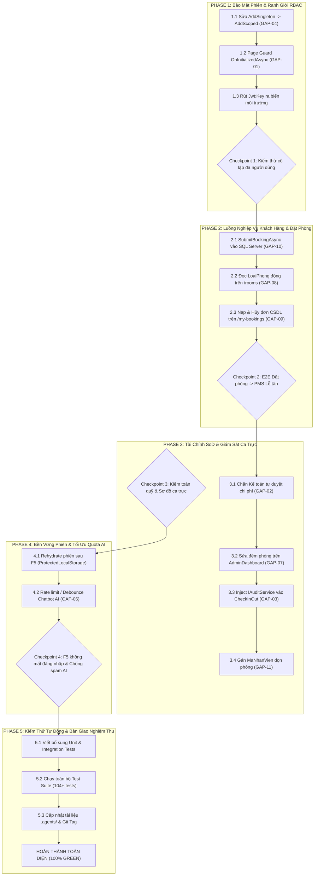

# 📋 KẾ HOẠCH HÀNH ĐỘNG TỔNG THỂ (MASTER REMEDIATION PLAN)
## Dự Án: BookingStay.AI — Quản Lý Khách Sạn & Trợ Lý Du Lịch (DACN)

> **Mã kế hoạch:** `PLAN-2026-DACN-REMEDIATION`  
> **Căn cứ tài liệu:** [intended_vs_implemented.md](file:///d:/THAI_ANH_KY_WORKSPACE/Projects/DACN/.agents/intended_vs_implemented.md), [production_audit.md](file:///d:/THAI_ANH_KY_WORKSPACE/Projects/DACN/.agents/production_audit.md), [project_architecture.md](file:///d:/THAI_ANH_KY_WORKSPACE/Projects/DACN/.agents/project_architecture.md)  
> **Mục tiêu:** Xử lý triệt để 11 lỗ hổng nghiệp vụ & kiến trúc (GAP-01 đến GAP-11), đưa điểm sẵn sàng sản xuất từ **68/100 (Risky)** lên **95+/100 (Production-Ready)**.

---

## 🗺️ LỘ TRÌNH 5 GIAI ĐOẠN (EXECUTION ROADMAP)

---

## 📊 BẢNG KẾ HOẠCH HÀNH ĐỘNG TỔNG HỢP (MASTER REMEDIATION MATRIX)

| Phase | Mã Task | Lỗ Hổng / Vấn Đề | File Chịu Trách Nhiệm | Mức Độ | Hành Động Kỹ Thuật (Remediation) | Kiểm Thử / Checkpoint |
| :---: | :---: | :--- | :--- | :---: | :--- | :--- |
| **P1** | **T-1.1** | **GAP-04**: Rò rỉ phiên Singleton | `src/DACN.Web/Program.cs` | 🔴 Critical | Đổi `AddSingleton` sang `AddScoped<UserSessionService>()` | 2 trình duyệt riêng biệt đăng nhập chéo không bị đè phiên |
| **P1** | **T-1.2** | **GAP-01**: Thiếu Guard URL trang | `AccountManagement.razor`, `RbacMatrix.razor`, `AuditLogs.razor`, `VoucherManagement.razor` | 🔴 Cao | Thêm kiểm tra `Session.HasPermission(...)` trong `OnInitializedAsync()` | Lễ tân / Buồng phòng gõ trực tiếp URL bị redirect về `/admin/dashboard` |
| **P1** | **T-1.3** | **Prod Block**: Khóa bí mật JWT | `src/DACN.Web/appsettings.json` | 🔴 Cao | Nạp fallback từ biến môi trường `ASPNETCORE_JWT__KEY` | Khởi động server không lộ secret trong git, đọc biến môi trường thành công |
| **P2** | **T-2.1** | **GAP-10**: Form đặt phòng ảo | `src/DACN.Web/Components/Pages/Home.razor` | 🔴 Critical | Tái cấu trúc `SubmitBookingAsync` chèn thực thể `DatPhong` & `ChiTietDatPhong` vào SQL Server | Đặt phòng trên Home -> SQL có record mới -> Lễ tân PMS thấy đơn |
| **P2** | **T-2.2** | **GAP-08**: Hạng phòng hardcode | `src/DACN.Web/Components/Pages/Customer/RoomsList.razor` | 🟡 Trung bình | Truy vấn động `Db.LoaiPhongs.AsNoTracking().Where(l => l.DangHoatDong)` | Thêm/sửa giá phòng trong DB phản ánh ngay lên trang `/rooms` |
| **P2** | **T-2.3** | **GAP-09**: Lịch sử phòng mock data | `src/DACN.Web/Components/Pages/Customer/MyBookings.razor` | 🔴 Cao | Truy vấn `Db.DatPhongs` theo `Session.CurrentUser.Id`; Cập nhật hủy đơn vào SQL | Khách thấy đúng đơn vừa đặt; bấm Hủy đơn cập nhật `TrangThai = 'Cancelled'` |
| **P3** | **T-3.1** | **GAP-02**: Kế toán tự duyệt chi phí | `src/DACN.Web/Components/Pages/ThanhVien3_TienSanh/ExpenseManagement.razor` | 🔴 Cao | Ràng buộc Four-Eyes: Chỉ Admin/Manager duyệt, cấm `expense.NguoiTaoId == Session.CurrentUser.Id` | Kế toán tạo phiếu không có nút Duyệt; Quản lý vào duyệt thành công |
| **P3** | **T-3.2** | **GAP-07**: Sai logic đếm phòng ca trực | `src/DACN.Web/Components/Pages/AdminDashboard.razor` | 🔴 Cao | Dùng `StatusMapper.IsRoomOccupied(r.TrangThai)` và đếm dọn phòng trên `r.TrangThaiVeSinh` | Thẻ KPI Dashboard hiển thị số phòng lưu trú & phòng cần dọn thực tế |
| **P3** | **T-3.3** | **GAP-03**: Thiếu Audit Log Check-out | `src/DACN.Web/Components/Pages/ThanhVien2_BuongPhong/CheckInOut.razor` | 🟡 Trung bình | Inject `IAuditService` và ghi `CHECK_OUT_QUYET_TOAN` khi thu tiền trả phòng | Sau khi check-out, bảng `NhatKyHeThong` ghi nhận đầy đủ tiền thu & người thao tác |
| **P3** | **T-3.4** | **GAP-11**: Không định danh ca dọn phòng | `src/DACN.Web/Components/Pages/ThanhVien2_BuongPhong/CleaningTasks.razor` | 🟡 Trung bình | Inject `UserSessionService`, gán `task.MaNhanVien = Session.CurrentUser.Id` khi bắt đầu dọn | Bảng nhật ký dọn phòng hiển thị họ tên nhân viên thực hiện ca dọn |
| **P4** | **T-4.1** | **UX F5**: Mất phiên khi reload | `src/DACN.Web/Components/Layout/CustomerLayout.razor`, `MainLayout.razor` | 🟡 Trung bình | Tích hợp `ProtectedLocalStorage` lưu token phiên làm việc, tự động rehydrate khi F5 | Đăng nhập -> nhấn F5 trên trình duyệt -> phiên vẫn giữ nguyên vai trò |
| **P4** | **T-4.2** | **GAP-06**: Quota Gemini AI Chatbot | `CustomerLayout.razor`, `AiChatbot.razor` | 🟢 Thấp | Thêm debounce 2 giây, giới hạn trần 5 câu hỏi/phiên đối với khách vãng lai | Spam click không tạo request liên tiếp; khách vãng lai bị nhắc đăng nhập |
| **P5** | **T-5.1** | **QA**: Bổ sung Unit/Integration Tests | `tests/DACN.UnitTests/`, `tests/DACN.IntegrationTests/` | 🟢 Cao | Viết test kiểm tra cách ly Scoped session, kiểm soát SoD, E2E Booking | `dotnet test` vượt qua toàn bộ 104+ test suites (0 fail) |
| **P5** | **T-5.2** | **Bàn giao**: Nâng điểm Prod-Readiness | `.agents/production_audit.md`, `.agents/intended_vs_implemented.md` | 🟢 Hoàn tất | Cập nhật toàn bộ trạng thái các GAP sang "Đã khắc phục", nâng điểm lên 95+/100 | Báo cáo kiểm định đạt chuẩn bàn giao và nghiệm lưu trữ Git |

---

## 📌 CHI TIẾT TỪNG GIAI ĐOẠN, CHECKLIST & CHECKPOINT KIỂM THỬ

---

### 🛡️ PHASE 1: BẢO MẬT PHIÊN & RANH GIỚI RBAC CẤP TRANG (SECURITY & SESSION BOUNDARIES)
> **Mục tiêu:** Ngăn chặn ngay lập tức hiện tượng rò rỉ phiên đăng nhập chéo giữa các máy/trình duyệt và khóa chặt các trang quản trị nhạy cảm trước tài khoản nội bộ cấp thấp.

#### 1. Danh sách công việc (Checklist)
- [ ] **Task 1.1 (Khẩn cấp - GAP-04):** Đổi đăng ký DI trong [Program.cs](file:///d:/THAI_ANH_KY_WORKSPACE/Projects/DACN/src/DACN.Web/Program.cs#L39):
  - Chuyển `builder.Services.AddSingleton<UserSessionService>();` $\rightarrow$ `builder.Services.AddScoped<UserSessionService>();`.
  - Đảm bảo mỗi kết nối SignalR Circuit của Blazor Server sở hữu một instance `UserSessionService` hoàn toàn độc lập.
- [ ] **Task 1.2 (GAP-01):** Thêm Page-Level Route Guard trong `OnInitializedAsync()`:
  - [AccountManagement.razor](file:///d:/THAI_ANH_KY_WORKSPACE/Projects/DACN/src/DACN.Web/Components/Pages/ThanhVien1_BaoMat/AccountManagement.razor): Kiểm tra `if (!Session.HasPermission(Quyen.ManageUsers)) { Nav.NavigateTo("/admin/dashboard"); return; }`.
  - [RbacMatrix.razor](file:///d:/THAI_ANH_KY_WORKSPACE/Projects/DACN/src/DACN.Web/Components/Pages/ThanhVien1_BaoMat/RbacMatrix.razor): Kiểm tra `if (!Session.HasPermission(Quyen.ManageUsers)) { Nav.NavigateTo("/admin/dashboard"); return; }`.
  - [AuditLogs.razor](file:///d:/THAI_ANH_KY_WORKSPACE/Projects/DACN/src/DACN.Web/Components/Pages/ThanhVien1_BaoMat/AuditLogs.razor): Kiểm tra `if (!Session.CanAccessAdmin()) { Nav.NavigateTo("/admin/dashboard"); return; }`.
  - [VoucherManagement.razor](file:///d:/THAI_ANH_KY_WORKSPACE/Projects/DACN/src/DACN.Web/Components/Pages/ThanhVien1_BaoMat/VoucherManagement.razor): Thêm guard vào `ToggleVoucherAsync()` và kiểm tra quyền trong `OnInitializedAsync()`.
- [ ] **Task 1.3 (Bảo mật Prod):** Cấu hình `Jwt:Key` an toàn trong [appsettings.json](file:///d:/THAI_ANH_KY_WORKSPACE/Projects/DACN/src/DACN.Web/appsettings.json#L6):
  - Hỗ trợ fallback nạp từ biến môi trường `ASPNETCORE_JWT__KEY`.
  - Thêm cảnh báo log nếu ứng dụng chạy ở môi trường Production với khóa bí mật mặc định.

#### 2. Checkpoint Kiểm Thử 1 (Verification Checkpoint 1)
- [ ] **Test Case 1.1 (Đa người dùng chéo):**
  - Mở Trình duyệt A (Chrome): Đăng nhập tài khoản `admin@hotel.com`.
  - Mở Trình duyệt B (Edge / Incognito): Truy cập `https://localhost:7136/`.
  - *Kết quả mong đợi:* Trình duyệt B hiển thị đúng là `Khách Vãng Lai` (Customer), **không bị nhận nhầm thành Admin**.
  - Trình duyệt B bấm Đăng nhập/Đăng xuất $\rightarrow$ Trình duyệt A vẫn giữ nguyên phiên Admin, **không bị văng đăng xuất**.
- [ ] **Test Case 1.2 (URL Route Guard):**
  - Đăng nhập tài khoản Lễ tân (`letan@hotel.com`) hoặc Buồng phòng (`buongphong@hotel.com`).
  - Gõ trực tiếp trên thanh địa chỉ: `/admin/accounts`, `/admin/rbac`, `/admin/audit-logs`.
  - *Kết quả mong đợi:* Hệ thống lập tức chuyển hướng về `/admin/dashboard`, không nạp bất kỳ danh sách người dùng hay audit log nào vào bộ nhớ RAM.
- [ ] **Test Case 1.3 (Automated Tests):** Chạy `dotnet test --no-restore` xác nhận không bị phá vỡ 104 test hiện có.

---

### 🏨 PHASE 2: LUỒNG NGHIỆP VỤ KHÁCH HÀNG & TOÀN VẸN ĐẶT PHÒNG (CUSTOMER BOOKING PIPELINE)
> **Mục tiêu:** Nối thông luồng dữ liệu từ giao diện đặt phòng của khách hàng (`Home.razor`, `RoomsList.razor`, `MyBookings.razor`) vào thẳng cơ sở dữ liệu SQL Server và đồng bộ với màn hình lễ tân PMS.

#### 1. Danh sách công việc (Checklist)
- [ ] **Task 2.1 (GAP-10):** Tái cấu trúc hàm `SubmitBooking()` trong [Home.razor](file:///d:/THAI_ANH_KY_WORKSPACE/Projects/DACN/src/DACN.Web/Components/Pages/Home.razor#L758-L763):
  - Chuyển thành `SubmitBookingAsync()`.
  - Khởi tạo thực thể `DatPhong` chuẩn:
    * `MaDatPhong = $"DP-WEB-{DateTime.UtcNow:yyMMddHHmm}"`
    * `MaKhachHang = Session.CurrentUser.IsLoggedIn ? Session.CurrentUser.Id : guestUser.Id`
    * `NgayNhanPhong = checkInDate`, `NgayTraPhong = checkOutDate`
    * `TongTien = finalTotal`, `TienDatCoc = depositAmount`
    * `TrangThai = "Pending"`, `KenhDatPhong = "web"`
  - Tạo `ChiTietDatPhong` liên kết đúng `MaLoaiPhong` được chọn.
  - Xử lý voucher: Nếu có áp dụng mã hợp lệ, tăng `v.SoLanDaDung += 1`.
  - Thực thi trong `await using var tx = await Db.Database.BeginTransactionAsync(IsolationLevel.Serializable)`.
  - Gọi `IAuditService.GhiNhanAsync(...)` để ghi nhận sự kiện đặt phòng mới.
- [ ] **Task 2.2 (GAP-08):** Đọc động danh mục hạng phòng trong [Customer/RoomsList.razor](file:///d:/THAI_ANH_KY_WORKSPACE/Projects/DACN/src/DACN.Web/Components/Pages/Customer/RoomsList.razor):
  - Thay thế `roomsList` tĩnh bằng truy vấn `Db.LoaiPhongs.AsNoTracking().Where(l => l.DangHoatDong).ToListAsync()`.
  - Map linh hoạt sang View Model giữ nguyên ảnh minh họa và tiện nghi.
- [ ] **Task 2.3 (GAP-09):** Đồng bộ dữ liệu lịch sử đặt phòng trong [Customer/MyBookings.razor](file:///d:/THAI_ANH_KY_WORKSPACE/Projects/DACN/src/DACN.Web/Components/Pages/Customer/MyBookings.razor):
  - Truy vấn đơn thật từ `Db.DatPhongs.Where(dp => dp.MaKhachHang == Session.CurrentUser.Id || dp.EmailNguoiDat == Session.CurrentUser.Email)`.
  - Viết lại hàm `CancelBookingAsync(int id)`: Cập nhật `DatPhong.TrangThai = "Cancelled"`, cập nhật ngày hủy và gọi `Db.SaveChangesAsync()`.

#### 2. Checkpoint Kiểm Thử 2 (Verification Checkpoint 2)
- [ ] **Test Case 2.1 (E2E Đặt phòng Web):**
  - Đóng vai khách hàng: Vào `Home.razor`, chọn Hạng phòng Deluxe, nhập mã voucher `WELCOME2026`, điền thông tin và bấm **"Xác Nhận Đặt Phòng"**.
  - Mở SQL Server / Studio: Kiểm tra bảng `DatPhong` có bản ghi mới với mã `DP-WEB-...`, tổng tiền đã trừ voucher, `TrangThai = "Pending"`.
- [ ] **Test Case 2.2 (Màn hình Lễ tân PMS nhận đơn):**
  - Mở trang [RoomRackBookings.razor](file:///d:/THAI_ANH_KY_WORKSPACE/Projects/DACN/src/DACN.Web/Components/Pages/ThanhVien2_BuongPhong/RoomRackBookings.razor) (`/frontdesk/bookings`).
  - *Kết quả mong đợi:* Đơn vừa đặt ở Test Case 2.1 xuất hiện ngay trên danh sách đơn đặt phòng chờ xử lý của Lễ tân.
- [ ] **Test Case 2.3 (Trang Portal Khách hàng):**
  - Khách hàng đăng nhập tài khoản vào `/my-bookings`.
  - *Kết quả mong đợi:* Nhìn thấy đúng đơn vừa đặt; bấm **"Hủy Phòng"** $\rightarrow$ Trạng thái chuyển thành "Đã hủy đơn" và CSDL cập nhật `TrangThai = 'Cancelled'`.

---

### 💰 PHASE 3: TÀI CHÍNH SOD & GIÁM SÁT VẬN HÀNH CA TRỰC (FINANCIAL CONTROL & SRE)
> **Mục tiêu:** Áp dụng nguyên tắc Four-Eyes trong tài chính chi phí, sửa triệt để lỗi logic hiển thị thống kê ca trực và đảm bảo mọi thao tác phòng buồng đều gắn liền với định danh nhân viên.

#### 1. Danh sách công việc (Checklist)
- [ ] **Task 3.1 (GAP-02):** Khắc phục vi phạm Segregation of Duties trong [ExpenseManagement.razor](file:///d:/THAI_ANH_KY_WORKSPACE/Projects/DACN/src/DACN.Web/Components/Pages/ThanhVien3_TienSanh/ExpenseManagement.razor):
  - Điều chỉnh nút bấm Duyệt chi: Chỉ hiển thị khi `(Session.CurrentUser.Role is "Admin" or "Manager") && expense.NguoiTaoId != Session.CurrentUser.Id`.
  - Trong phương thức C# `ApproveExpenseAsync`: Thêm guard kiểm tra phía máy chủ, chặn kế toán tự duyệt phiếu chi do mình lập.
- [ ] **Task 3.2 (GAP-07):** Sửa lỗi logic đếm phòng trong [AdminDashboard.razor](file:///d:/THAI_ANH_KY_WORKSPACE/Projects/DACN/src/DACN.Web/Components/Pages/AdminDashboard.razor#L173-L174):
  - Đổi `rooms.Count(r => r.TrangThai == "dang_o")` $\rightarrow$ `rooms.Count(r => StatusMapper.IsRoomOccupied(r.TrangThai))`.
  - Đổi `rooms.Count(r => r.TrangThai == "don_dep" || ...)` $\rightarrow$ `rooms.Count(r => r.TrangThaiVeSinh is "Dirty" or "Inspecting")`.
- [ ] **Task 3.3 (GAP-03):** Bổ sung `IAuditService` trong [CheckInOut.razor](file:///d:/THAI_ANH_KY_WORKSPACE/Projects/DACN/src/DACN.Web/Components/Pages/ThanhVien2_BuongPhong/CheckInOut.razor):
  - Thêm `@inject IAuditService AuditService`.
  - Ghi nhận `CHECK_IN_NHAN_PHONG` khi khách nhận chìa khóa.
  - Ghi nhận `CHECK_OUT_QUYET_TOAN` khi khách thanh toán trả phòng, lưu rõ số tiền thu và phương thức (tiền mặt / chuyển khoản).
- [ ] **Task 3.4 (GAP-11):** Gán nhân viên dọn phòng trong [CleaningTasks.razor](file:///d:/THAI_ANH_KY_WORKSPACE/Projects/DACN/src/DACN.Web/Components/Pages/ThanhVien2_BuongPhong/CleaningTasks.razor):
  - Thêm `@inject UserSessionService Session`.
  - Trong `UpdateTaskAsync`: Khi trạng thái chuyển sang `"in_progress"` hoặc `"done"`, tự động gán `task.MaNhanVien = Session.CurrentUser.Id` nếu nhân viên đang thao tác.

#### 2. Checkpoint Kiểm Thử 3 (Verification Checkpoint 3)
- [ ] **Test Case 3.1 (Tài chính Four-Eyes):**
  - Đăng nhập Kế toán (`accountant@hotel.com`) $\rightarrow$ Tạo phiếu chi tiền mua hóa chất vệ sinh 2.000.000đ.
  - *Kết quả mong đợi:* Trên dòng phiếu chi này, tài khoản kế toán **KHÔNG có nút Duyệt**.
  - Đăng nhập Quản lý (`manager@hotel.com`) $\rightarrow$ Thấy nút **"Duyệt"** và bấm duyệt thành công.
- [ ] **Test Case 3.2 (Thống kê Dashboard ca trực):**
  - Mở `/admin/dashboard`.
  - *Kết quả mong đợi:* Thẻ "Khách Đang Ở" và "Phòng Cần Dọn" hiển thị số lượng thực tế khớp với dữ liệu trong database (không còn bị số 0 ảo).
- [ ] **Test Case 3.3 (Nhật ký ca trực buồng phòng):**
  - Đăng nhập Buồng phòng (`buongphong@hotel.com`) $\rightarrow$ Vào `/housekeeping/tasks` bấm **"Bắt đầu dọn"** phòng 101.
  - *Kết quả mong đợi:* Cột "Nhân viên" hiển thị đúng tên "Lê Thị Buồng Phòng", không còn là "Chưa phân công".

---

### ⚡ PHASE 4: BỀN VỮNG PHIÊN BLAZOR & QUOTA AI (SESSION RESILIENCE & AI DEFENSE)
> **Mục tiêu:** Cải thiện trải nghiệm người dùng không bị mất đăng nhập khi nhấn F5 và bảo vệ hạn mức gọi Gemini 2.5 Flash API.

#### 1. Danh sách công việc (Checklist)
- [ ] **Task 4.1 (Circuit Rehydration):**
  - Sử dụng `ProtectedLocalStorage` trong `App.razor` hoặc `CustomerLayout.razor` / `MainLayout.razor`.
  - Khi người dùng đăng nhập thành công: Lưu token/user info tối thiểu vào local storage mã hóa.
  - Khi tải lại trang (F5): Kiểm tra và khôi phục (rehydrate) trạng thái vào `UserSessionService`.
- [ ] **Task 4.2 (GAP-06):** Phòng thủ hạn mức AI Chatbot trong [CustomerLayout.razor](file:///d:/THAI_ANH_KY_WORKSPACE/Projects/DACN/src/DACN.Web/Components/Layout/CustomerLayout.razor) & [AiChatbot.razor](file:///d:/THAI_ANH_KY_WORKSPACE/Projects/DACN/src/DACN.Web/Components/Pages/ThanhVien4_AICore/AiChatbot.razor):
  - Khóa nút gửi kèm thời gian cooldown 2 giây sau mỗi câu hỏi.
  - Giới hạn 5 câu hỏi/phiên đối với `Khách vãng lai`; nếu vượt quá thì nhắc đăng nhập để tiếp tục.

#### 2. Checkpoint Kiểm Thử 4 (Verification Checkpoint 4)
- [ ] **Test Case 4.1 (F5 Reload Test):**
  - Đăng nhập tài khoản Lễ tân $\rightarrow$ Nhấn **F5** trên trình duyệt.
  - *Kết quả mong đợi:* Trình duyệt vẫn hiển thị avatar và vai trò Lễ tân, không bị văng về Khách vãng lai.
- [ ] **Test Case 4.2 (Spam Click Chatbot):**
  - Gõ câu hỏi và nhấn liên tiếp nhiều lần.
  - *Kết quả mong đợi:* Chỉ có 1 request được xử lý; các lượt click nhanh bị chặn bởi cooldown.

---

### 🧪 PHASE 5: KIỂM THỬ TỰ ĐỘNG, ĐỒNG BỘ TÀI LIỆU & BÀN GIAO (AUTOMATION & CLOSURE)
> **Mục tiêu:** Bảo toàn 100% test suite, viết bổ sung test tự động cho các luồng vừa vá và đồng bộ tài liệu kiến trúc.

#### 1. Danh sách công việc (Checklist)
- [ ] **Task 5.1:** Bổ sung Unit Tests trong `tests/DACN.UnitTests`:
  - `UserSessionServiceTests`: Kiểm thử tính độc lập của Scoped service giữa các Circuit.
  - `ExpenseApprovalTests`: Kiểm thử logic chặn tự duyệt chi phí.
  - `DashboardStatsTests`: Kiểm thử logic tính toán số phòng lưu trú và vệ sinh.
- [ ] **Task 5.2:** Bổ sung Integration Tests trong `tests/DACN.IntegrationTests`:
  - `BookingPipelineTests`: Kiểm thử E2E tạo đơn đặt phòng web vào CSDL.
- [ ] **Task 5.3:** Cập nhật lại toàn bộ trạng thái trong `.agents/intended_vs_implemented.md` (chuyển các GAP từ Đang mở sang Đã khắc phục).
- [ ] **Task 5.4:** Nâng điểm trong `.agents/production_audit.md` lên **95+/100 (Prod-Ready)**.
- [ ] **Task 5.5:** Tạo Git commit chuẩn mực đóng gói toàn bộ quá trình khắc phục.

#### 2. Checkpoint Kiểm Thử 5 (Final Green Checkpoint)
- [ ] `dotnet build`: Succeeded với **0 Warning, 0 Error**.
- [ ] `dotnet test`: **100% Pass** (104 test cũ + các test mới).
- [ ] Kiểm tra tính toàn vẹn ký tự Tiếng Việt (UTF-8 with BOM) trên tất cả các file đã sửa.

---

## 🛑 ĐIỂM DỪNG BÁO CÁO & XÁC NHẬN (CONFIRMATION GATE)

> [!IMPORTANT]
> **Kế hoạch đã được lập chi tiết đầy đủ 5 Phase và đồng bộ vào thư mục `.agents/`.**  
> Tuân thủ tuyệt đối quy trình **Understand $\rightarrow$ Analyze $\rightarrow$ Plan $\rightarrow$ Implement $\rightarrow$ Verify $\rightarrow$ Explain** và nguyên tắc Planning Mode: **Không thực hiện bất kỳ sửa đổi code nào trước khi bạn kiểm tra và duyệt kế hoạch này.**
